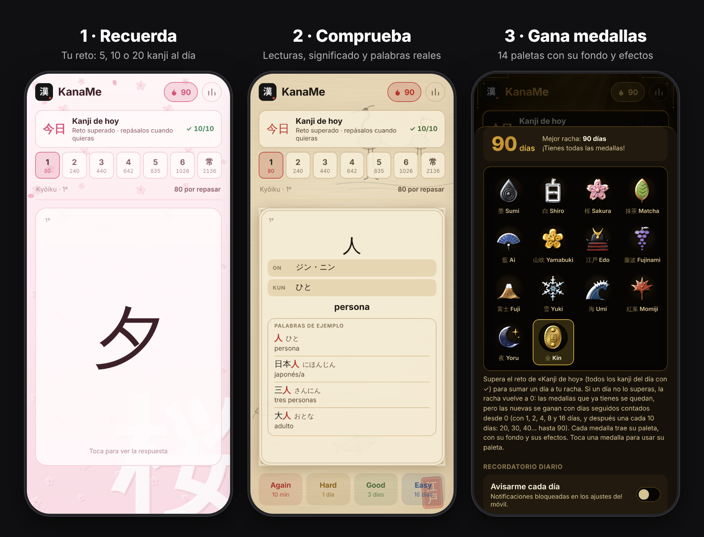

<div align="center">


# KanaMe

### Aprende los 2136 kanji Jōyō en meses, no en años.

Flashcards con repetición espaciada, pensadas para el móvil.<br>
Sin cuentas · Sin anuncios · Funciona sin conexión

**[▶ Abrir KanaMe](https://lucass-05.github.io/KanaMe-Kanji/)**


</div>

<br>

<p align="center"></p>

## Cómo funciona

1. **Recuerda.** La tarjeta muestra solo el kanji. Intenta recordar cómo se lee y qué significa.
2. **Comprueba.** Toca la tarjeta para ver sus lecturas *on* y *kun*, el significado en español y palabras de uso real con el kanji resaltado.
3. **Valora.** Di cuánto te ha costado y KanaMe decide cuándo enseñártelo de nuevo:

| | Again | Hard | Good | Easy |
|---|:---:|:---:|:---:|:---:|
| **Vuelve en** | 10 min | 1 día | 3 días | 16 días |

Tu progreso se guarda solo en el móvil y se comparte entre niveles: lo que ya sabes no vuelve a salir hasta que toca.

## Kanji de hoy, racha y paletas

- **今日 Kanji de hoy.** Cada día, al abrir la app, KanaMe prepara 20 kanji nuevos elegidos al azar del nivel más sencillo que aún tengas sin estudiar. La lista se genera una sola vez al día y sin conexión.
- **🔥 Racha.** Completa los 20 kanji del día para sumar un día a tu racha.
- **🔔 Recordatorio diario.** La primera vez que abres la app te ofrece un aviso diario a la hora que elijas. Si ese día ya has hecho tus kanji, no te molesta. La hora se cambia o se desactiva en *Progreso*.
- **Paletas de colores.** Cada 10 días seguidos desbloqueas una paleta nueva: 桜 Sakura, 抹茶 Matcha, 藍 Ai, 山吹 Yamabuki, 藤 Fuji, 海 Umi, 紅葉 Momiji, 夜 Yoru… y 金 Kin a los 100 días. Las paletas ganadas no se pierden aunque se rompa la racha.

## Por qué se aprende tan rápido

KanaMe aplica las dos técnicas de estudio con más respaldo científico:

- **Recuerdo activo.** Intentar recordar antes de ver la respuesta fija la memoria mucho mejor que releer listas (el *testing effect*).
- **Repetición espaciada.** Cada kanji vuelve justo antes de que lo olvides. Los que dominas se alejan solos y tu tiempo se dedica solo a los que te cuestan.

A esto se suman tres decisiones de diseño:

- **Palabras reales, no lecturas sueltas.** Cada kanji viene con 1–4 palabras comunes que muestran sus distintas lecturas en contexto: 上 es *ue* en 上, *jō* en 上手 y *a(garu)* en 上がる.
- **Orden pedagógico.** Los kanji siguen el orden en que se aprenden en la escuela japonesa, así que los simples sirven de pieza para los complejos.
- **Sesiones cortas.** Diez minutos al día bastan.

> **Con 20 kanji nuevos al día recorres la lista Jōyō completa en unos 4 meses.**

## Niveles

Cada nivel incluye todos los anteriores.

| 1 | 2 | 3 | 4 | 5 | 6 | 常 |
|:---:|:---:|:---:|:---:|:---:|:---:|:---:|
| Kyōiku 1º | 1º–2º | 1º–3º | 1º–4º | 1º–5º | Kyōiku completo | **Jōyō completo** |
| 80 | 240 | 440 | 642 | 835 | 1026 | **2136** |

## Instalar en el móvil

Añádela a la pantalla de inicio y se abrirá a pantalla completa, como una app nativa.

| iPhone (Safari) | Samsung / Android |
|:---:|:---:|
|  |  |
| **Compartir → Añadir a pantalla de inicio** | **Menú ≡ → Añadir página a → Pantalla de inicio**<br><sub>En Chrome: ⋮ → Añadir a pantalla de inicio</sub> |

> En iOS, Safari y el icono de inicio guardan el progreso por separado. Estudia siempre desde el icono, o pasa tu progreso con **Progreso → Copia de seguridad**.

## Privacidad

Sin registro. Tu progreso, tu racha y tus kanji del día se guardan solo en tu dispositivo, con copia en dos almacenes del navegador. Puedes exportarlo como código o archivo y restaurarlo en otro móvil.

Si activas el recordatorio, el servidor de avisos guarda solo la dirección anónima de notificaciones de tu móvil, la hora elegida y el último día que completaste. Al desactivarlo se borra.

Para saber cuánta gente usa la app se cuentan las visitas de forma anónima con [GoatCounter](https://www.goatcounter.com): sin cookies, sin datos personales y sin seguimiento entre webs.

## Familia KanaMe

- **[KanaMe Kana](https://github.com/lucass-05/KanaMe-Kana)**: hiragana y katakana. El primer paso si aún no lees kana con soltura.
- **KanaMe Kanji**: los 2136 kanji Jōyō (esta app).

## Para desarrolladores

HTML, CSS y JavaScript puros, sin dependencias ni compilación.

```bash
python3 -m http.server 8000   # y abre http://localhost:8000
```

| Archivo | Contenido |
|---|---|
| `index.html` | Interfaz y lógica de la app |
| `data/kanji.js` | Los 2136 kanji: `[kanji, on, kun, significado, palabras]` |
| `sw.js` | Service worker: modo sin conexión y avisos del recordatorio. Sube `VERSION` al publicar cambios |
| `push/` | Servidor de recordatorios diarios (Cloudflare Worker) y [guía para ponerlo en marcha](push/README.md) |
| `csv/` | Mazos en CSV para Anki, Quizlet y similares |
| `icons/` | Iconos para iOS, Android y navegador |

## Créditos

- Lecturas: [KANJIDIC2](https://www.edrdg.org/wiki/index.php/KANJIDIC_Project) (EDRDG, CC BY-SA 4.0), vía [kanji-data](https://github.com/davidluzgouveia/kanji-data).
- Significados en español y palabras de ejemplo: elaboración propia.
- Listas oficiales: 常用漢字表 (2010) y 学年別漢字配当表 (MEXT, 2020).

## Licencia

© 2026 Lucas Suárez. Código publicado bajo la licencia **[GNU AGPL-3.0](LICENSE)**.

Puedes usar y estudiar KanaMe libremente. Si copias o modificas el código y lo distribuyes o lo publicas como web o app, debes mantener el aviso de autoría y publicar tu código completo bajo la misma licencia. Los datos de lecturas derivados de KANJIDIC2 conservan su licencia CC BY-SA 4.0.

<div align="center"><sub>Hecho con 墨 y paciencia · がんばって！</sub></div>
