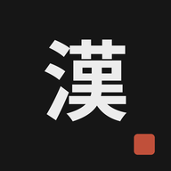
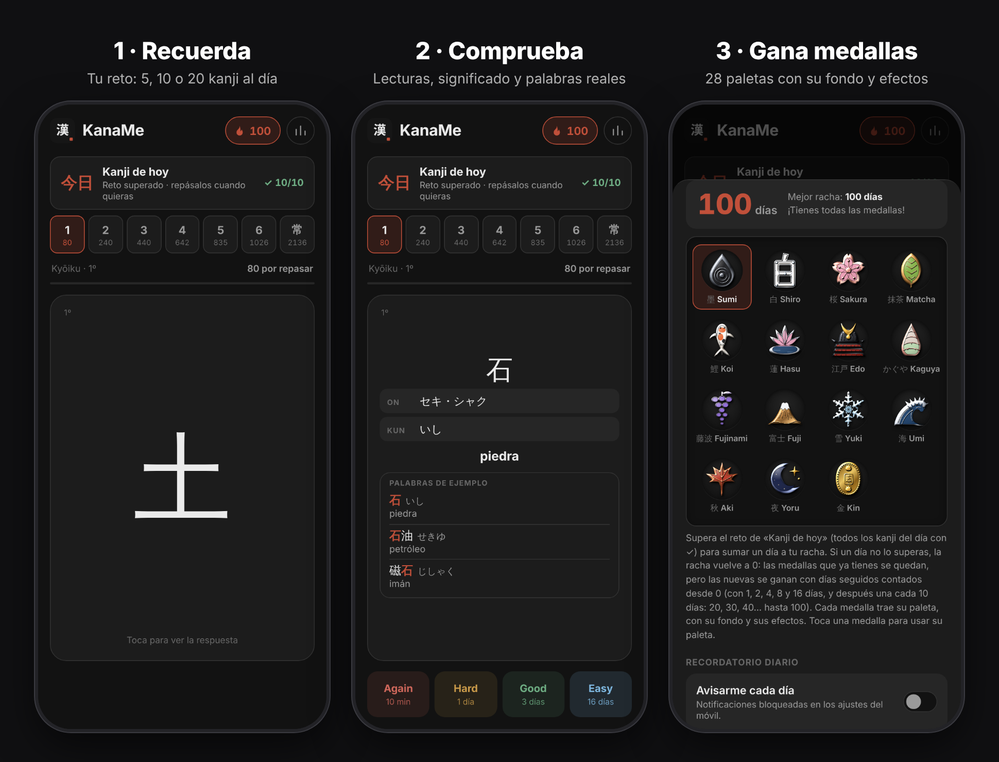
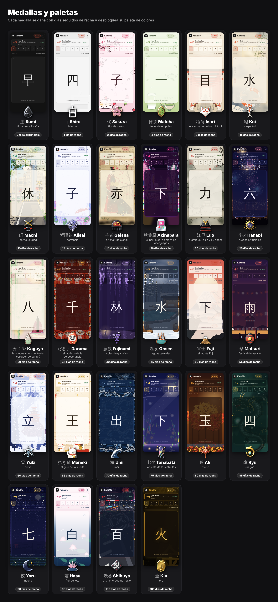
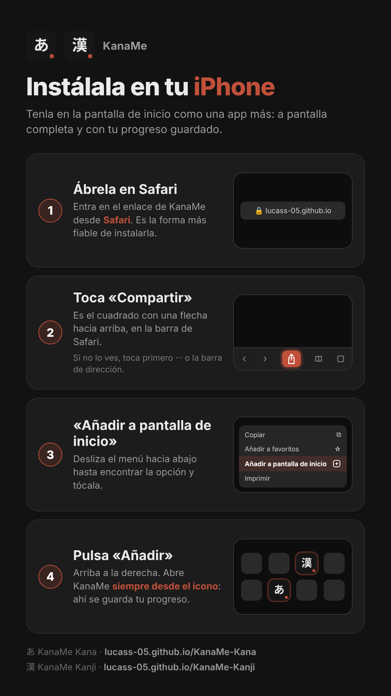
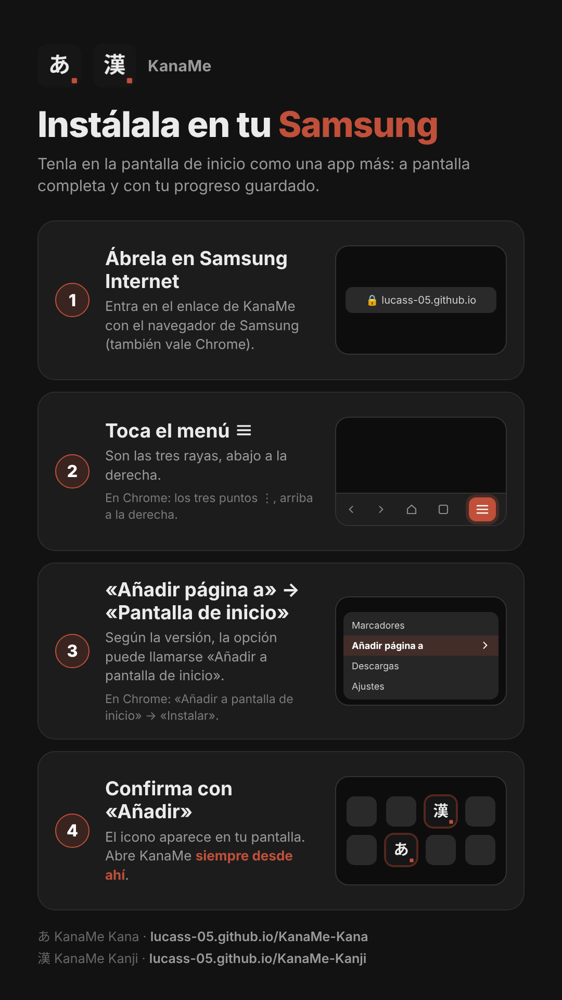

<div align="center">



# KanaMe

### Aprende los 2136 kanji Jōyō en meses, no en años.

Flashcards con repetición espaciada, pensadas para el móvil.<br>
Sin cuentas · Sin anuncios · Funciona sin conexión

**[▶ Abrir KanaMe](https://lucass-05.github.io/KanaMe-Kanji/)**


</div>

<br>

<p align="center"></p>

## Cómo funciona

1. **Recuerda.** La tarjeta muestra solo el kanji. Intenta recordar cómo se lee y qué significa.
2. **Comprueba.** Toca la tarjeta para ver sus lecturas *on* y *kun*, el significado en español y palabras de uso real con el kanji resaltado.
3. **Valora.** Di cuánto te ha costado y KanaMe decide cuándo enseñártelo de nuevo:

| | Again | Hard | Good | Easy |
|---|:---:|:---:|:---:|:---:|
| **Vuelve en** | 10 min | 1 día | 3 días | 16 días |

Cada vez que aciertas, la espera se multiplica (Good ×2,5, Easy ×3, Hard ×1,2) hasta un máximo de un año. Además, cada kanji tiene su propio multiplicador: baja un poco cuando lo fallas o te cuesta y sube un poco con Easy, así los difíciles vuelven más a menudo y los fáciles se alejan antes.

Tu progreso se guarda solo en el móvil y se comparte entre niveles: lo que ya sabes no vuelve a salir hasta que toca.

## Kanji de hoy, racha y paletas

- **今日 Kanji de hoy.** Cada día, al abrir la app, KanaMe prepara tus kanji (5, 10 o 20, lo eliges la primera vez y puedes cambiarlo en Progreso) elegidos al azar del nivel más sencillo que aún tenga kanji disponibles: los que no has estudiado y los que ya han cumplido su tiempo de espera. Si en ese nivel no quedan suficientes, se completa con el siguiente. La lista se genera una sola vez al día y sin conexión.
- **🔥 Racha.** Supera el reto diario (todos los kanji de hoy marcados con ✓; los de ✕ se repiten hasta que te los sepas) para sumar un día a tu racha. En el reto, ✓ «Me lo sé» cuenta como Good y ✕ «Repetir» como Again, así que cada kanji sigue su calendario de repasos desde el primer día.
- **🔔 Recordatorio diario.** La primera vez que abres la app te ofrece un aviso diario a la hora que elijas. Si ese día ya has hecho tus kanji, no te molesta. La hora se cambia o se desactiva en *Progreso*.
- **Medallas y paletas.** Cada medalla tiene su silueta y su material (mármol, oro rosa, bronce, laca, nácar, plata…) y desbloquea una paleta con su propio fondo y efectos: 白 Shiro (1 día), 桜 Sakura (2), 抹茶 Matcha (4), 稲荷 Inari (6), 鯉 Koi (8), 町 Machi (10), 紫陽花 Ajisai (12), 芸者 Geisha (14), 秋葉原 Akihabara (16), 江戸 Edo (20) y desde ahí una cada 5 días: 花火 Hanabi (25), かぐや Kaguya (30), だるま Daruma (35), 藤波 Fujinami (40), 温泉 Onsen (45), 富士 Fuji (50), 祭 Matsuri (55), 雪 Yuki (60), 招き猫 Maneki (65), 海 Umi (70), 七夕 Tanabata (75), 秋 Aki (80), 龍 Ryū (85), 夜 Yoru (90), 蓮 Hasu (95), 渋谷 Shibuya (100) y 金 Kin (105). Edo, Kaguya y Geisha cambian además la letra a pincel; Machi, Akihabara, Hanabi, Tanabata y Shibuya tienen fondos animados (el tren, las pantallas, los fuegos, las luciérnagas y la multitud cruzando). Las ganadas no se pierden aunque se rompa la racha.

## Por qué se aprende tan rápido

KanaMe aplica las dos técnicas de estudio con más respaldo científico:

- **Recuerdo activo.** Intentar recordar antes de ver la respuesta fija la memoria mucho mejor que releer listas (el *testing effect*).
- **Repetición espaciada.** Cada kanji vuelve justo antes de que lo olvides. Los que dominas se alejan solos y tu tiempo se dedica solo a los que te cuestan.

A esto se suman tres decisiones de diseño:

- **Palabras reales, no lecturas sueltas.** Cada kanji viene con 1–4 palabras comunes que muestran sus distintas lecturas en contexto: 上 es *ue* en 上, *jō* en 上手 y *a(garu)* en 上がる.
- **Orden pedagógico.** Los kanji siguen el orden en que se aprenden en la escuela japonesa, así que los simples sirven de pieza para los complejos.
- **Sesiones cortas.** Diez minutos al día bastan.

> **Con 10 kanji nuevos al día te sabes los 1026 de primaria en unos 3 meses y medio, y la lista Jōyō completa en unos 7 meses. Con 20 al día, la mitad.**

## Niveles

Cada nivel incluye todos los anteriores.

| 1 | 2 | 3 | 4 | 5 | 6 | 常 |
|:---:|:---:|:---:|:---:|:---:|:---:|:---:|
| Kyōiku 1º | 1º–2º | 1º–3º | 1º–4º | 1º–5º | Kyōiku completo | **Jōyō completo** |
| 80 | 240 | 440 | 642 | 835 | 1026 | **2136** |

### Modo JLPT

En *Progreso → Modo de estudio* puedes cambiar a los niveles del **JLPT, del N5 al N1**. Cada nivel trae sus kanji y su vocabulario, y también incluye los anteriores. Las palabras tienen su propia tarjeta: por delante ves la palabra; al girarla, su lectura en hiragana y su significado, y debajo un recuadro con la ficha completa de uno de sus kanji. Toca otro kanji de la palabra para ver el suyo.

| N5 | N4 | N3 | N2 | N1 |
|:---:|:---:|:---:|:---:|:---:|
| 79 kanji + 432 palabras | +166 + 459 | +367 + 1524 | +367 + 1441 | +1232 + 2173 |

Los dos modos comparten el progreso: un kanji que ya has repasado en Jōyō aparece igual de repasado en JLPT, y al revés. «Kanji de hoy» funciona igual en los dos: toma las tarjetas del primer nivel que aún tenga alguna disponible. El JLPT no publica listas oficiales desde 2010; estas se basan en las de Jonathan Waller ([tanos.co.uk](http://www.tanos.co.uk/jlpt/)).

## Medallas y paletas

<p align="center"></p>

## Instalar en el móvil

Añádela a la pantalla de inicio y se abrirá a pantalla completa, como una app nativa.

| iPhone (Safari) | Samsung / Android |
|:---:|:---:|
|  |  |
| **Compartir → Añadir a pantalla de inicio** | **Menú ≡ → Añadir página a → Pantalla de inicio**<br><sub>En Chrome: ⋮ → Añadir a pantalla de inicio</sub> |

> En iOS, Safari y el icono de inicio guardan el progreso por separado. Estudia siempre desde el icono, o pasa tu progreso con **Progreso → Copia de seguridad**.

## Privacidad

Sin registro. Tu progreso, tu racha y tus kanji del día se guardan solo en tu dispositivo, con copia en dos almacenes del navegador. Puedes exportarlo como código o archivo y restaurarlo en otro móvil.

Si activas el recordatorio, el servidor de avisos guarda solo la dirección anónima de notificaciones de tu móvil, la hora elegida y el último día que completaste. Al desactivarlo se borra.

Para saber cuánta gente usa la app se cuentan las visitas de forma anónima con [GoatCounter](https://www.goatcounter.com): sin cookies, sin datos personales y sin seguimiento entre webs.

## Familia KanaMe

- **[KanaMe Kana](https://github.com/lucass-05/KanaMe-Kana)**: hiragana y katakana. El primer paso si aún no lees kana con soltura.
- **KanaMe Kanji**: los 2136 kanji Jōyō (esta app).

## Para desarrolladores

HTML, CSS y JavaScript puros (módulos ES), sin dependencias ni compilación. Hace falta un servidor local, porque los módulos no cargan con `file://`:

```bash
python3 -m http.server 8000   # y abre http://localhost:8000
```

### Estructura

```
index.html            solo el marcado de la página
css/
  app.css             interfaz: variables, niveles, tarjetas, hojas y tutorial
  palettes.css        fondos de las paletas, medallero y efectos
js/
  main.js             punto de entrada: ejecuta el init() de cada módulo en orden
  app/                la app
    state.js          estado compartido (progreso, reto de hoy, racha, nivel…)
    data.js           modo Jōyō/JLPT, niveles y tarjetas
    srs.js            repetición espaciada (plazos y multiplicador de cada tarjeta)
    storage.js        guardado en localStorage + IndexedDB
    daily.js          «Kanji de hoy»
    streak.js         racha, medallas y paletas desbloqueadas
    session.js        nivel elegido y cola de tarjetas
    ui.js             niveles, tarjetas (kanji y palabras) y valoraciones
    settings.js       ajustes, modo de estudio y copia de seguridad
    daily-size.js · from-group.js · reminder.js · tour.js · install.js · commands.js · lifecycle.js · start.js
  palettes/           las paletas
    list.js           la lista: colores, días de racha y efectos de cada paleta
    engine.js         aplica una paleta y dibuja su fondo
    medals.js         las medallas
    shapes.js · scenes-v5.js · scenes/   los dibujos de fondo (SVG generado por código)
data/
  kanji.js            los 2136 kanji: [kanji, on, kun, significado, palabras]
  jlpt.js             modo JLPT: kanji y palabras de N5 a N1, y los kanji que no son Jōyō
sw.js                 service worker: sin conexión y avisos. Sube VERSION y añade a CORE los archivos nuevos
push/                 servidor de recordatorios (Cloudflare Worker) y su guía
csv/                  mazos en CSV para Anki, Quizlet y similares
icons/                iconos para iOS, Android y navegador
```

Cómo se organiza el código:

- Cada módulo declara funciones y datos y exporta un `init()` con lo que tiene que hacer al arrancar (leer ajustes, enganchar botones…). `main.js` llama a los `init()` en orden, primero las paletas y luego la app.
- Lo que cambia mientras se usa la app y se toca desde varios módulos vive en `state` (`js/app/state.js`): `state.progress`, `state.daily`, `state.level`…
- Las paletas se comunican con la app por `window.KANAME_PALETTES`, `window.applyKanamePalette`, `window.KANAME_MEDAL` y `window.kanameBurst`.
- Para añadir una paleta: su entrada en `palettes/list.js` (o con `insertPal` desde un archivo de `palettes/scenes/`), su dibujo en `palettes/scenes/` y su `init()` en `main.js`.

## Créditos

- Lecturas: [KANJIDIC2](https://www.edrdg.org/wiki/index.php/KANJIDIC_Project) (EDRDG, CC BY-SA 4.0), vía [kanji-data](https://github.com/davidluzgouveia/kanji-data).
- Significados en español y palabras de ejemplo: elaboración propia.
- Niveles JLPT: listas no oficiales de Jonathan Waller ([tanos.co.uk](http://www.tanos.co.uk/jlpt/)), vía [kanji-data](https://github.com/davidluzgouveia/kanji-data) y [open-anki-jlpt-decks](https://github.com/jamsinclair/open-anki-jlpt-decks).
- Listas oficiales: 常用漢字表 (2010) y 学年別漢字配当表 (MEXT, 2020).

## Licencia

© 2026 Lucas Suárez. Código publicado bajo la licencia **[GNU AGPL-3.0](LICENSE)**.

Puedes usar y estudiar KanaMe libremente. Si copias o modificas el código y lo distribuyes o lo publicas como web o app, debes mantener el aviso de autoría y publicar tu código completo bajo la misma licencia. Los datos de lecturas derivados de KANJIDIC2 conservan su licencia CC BY-SA 4.0.

<div align="center"><sub>Hecho con 墨 y paciencia · がんばって！</sub></div>
