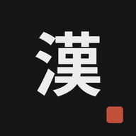
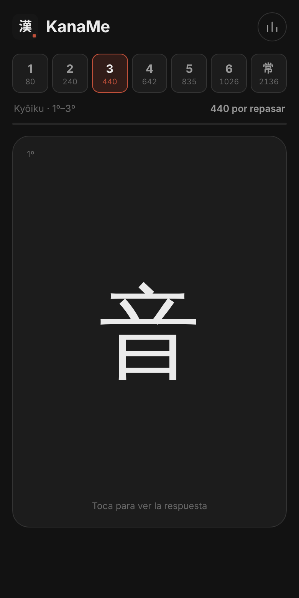
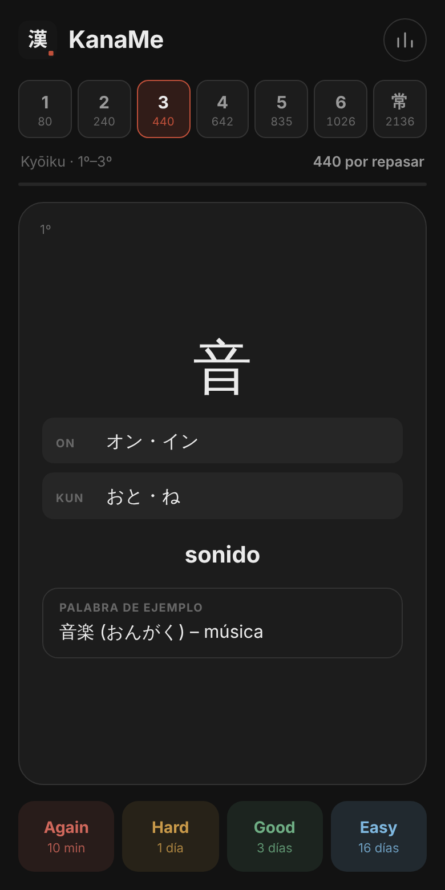

<div align="center">



# KanaMe

**Los 2136 kanji Jōyō, uno a uno, en el momento justo para no olvidarlos.**

Flashcards de repetición espaciada para el móvil. Sin cuentas, sin anuncios, sin instalar nada de la App Store.


&nbsp;&nbsp;&nbsp;

</div>

---

## ¿Qué es KanaMe?

KanaMe es una aplicación web (PWA) para aprender **todos los kanji que necesitas para leer japonés con soltura**: la lista oficial **Jōyō** (常用漢字), los 2136 caracteres que el Ministerio de Educación de Japón considera de uso general y que aparecen en periódicos, carteles, libros y documentos oficiales.

Se abre en el navegador, se añade a la pantalla de inicio del iPhone como una app más y guarda tu progreso automáticamente.

## Lo que puedes hacer

- **Estudiar por niveles acumulativos**, siguiendo el mismo orden en que los aprenden los niños japoneses.
- **Ver el kanji solo** en el anverso y, al tocar, el reverso con:
  - lecturas **on'yomi** (オン, en katakana) y **kun'yomi** (くん, en hiragana),
  - **significado en español**,
  - una **palabra de ejemplo** real con su lectura y traducción, para ver cómo se combina en el vocabulario.
- **Valorar cada tarjeta** y dejar que la app decida cuándo volver a enseñártela:

  | Botón | Cuándo vuelve |
  |---|---|
  | 🔴 **Again** | en 10 minutos (en la misma sesión) |
  | 🟡 **Hard** | en 1 día |
  | 🟢 **Good** | en 3 días |
  | 🔵 **Easy** | en 16 días |

- **Compartir progreso entre niveles**: un kanji que ya has repasado en el nivel 2 no te vuelve a salir en el nivel 6 hasta que le toque.
- **Ver de un vistazo cuánto te queda**: cada nivel muestra cuántas tarjetas tienes disponibles ahora, y una barra de progreso indica cuántas has estudiado ya.
- **Hacer copia de seguridad** de tu progreso (código o archivo) y restaurarla en otro móvil.
- **Usarla sin conexión**: tras la primera visita funciona en el metro o en el avión.
- **Exportar a otras apps**: la carpeta [`csv/`](csv) incluye los mazos en formato CSV (anverso/reverso) para importarlos en Anki, Sumi, Quizlet, etc.

## Los 7 niveles

Cada nivel **incluye todos los anteriores**, así que avanzar nunca significa abandonar lo aprendido.

| Nivel | Contenido | Kanji |
|:---:|---|---:|
| **1** | Kyōiku 1º de primaria | 80 |
| **2** | Kyōiku 1º – 2º | 240 |
| **3** | Kyōiku 1º – 3º | 440 |
| **4** | Kyōiku 1º – 4º | 642 |
| **5** | Kyōiku 1º – 5º | 835 |
| **6** | Kyōiku completo (教育漢字) | 1026 |
| **常** | **Jōyō completo (常用漢字)** | **2136** |

Los niveles 1–6 siguen la lista oficial de *kyōiku kanji* vigente desde 2020. El nivel 常 añade los 1110 kanji que se estudian en secundaria hasta completar la lista Jōyō.

## Por qué funciona

Aprender 2136 caracteres a base de repetirlos en una libreta es agotador y, sobre todo, ineficaz: se olvidan casi tan rápido como se aprenden. KanaMe se apoya en tres principios con décadas de investigación detrás:

### 1. La curva del olvido
Hermann Ebbinghaus demostró en 1885 que olvidamos lo aprendido siguiendo una curva predecible: muy rápido al principio y cada vez más despacio. Cada repaso hecho **justo antes de olvidar** aplana esa curva y hace que el recuerdo dure más.

### 2. Repetición espaciada
Repasar algo varias veces separadas en el tiempo es mucho más efectivo que repasarlo las mismas veces de golpe (el *efecto de espaciado*, uno de los resultados más sólidos de la psicología cognitiva). Los intervalos de KanaMe —10 minutos, 1 día, 3 días, 16 días— hacen que **solo dediques tiempo a los kanji que de verdad te cuestan**, mientras los que ya dominas se alejan solos.

### 3. Recuerdo activo
Ver el kanji solo y obligarte a recordar su lectura y significado **antes** de girar la tarjeta (en lugar de releer una lista) fortalece la memoria mucho más que el repaso pasivo. Es el *efecto de evaluación* (*testing effect*): intentar recordar es, en sí mismo, la forma de aprender.

### Y además…
- **Orden pedagógico.** Empiezas por 一, 人, 山… y los kanji simples se convierten en piezas de los complejos que vienen después.
- **Contexto real.** Cada kanji va acompañado de una palabra de uso común: aprendes cómo se *lee* de verdad en el vocabulario, no solo una lista de lecturas sueltas.
- **Sesiones cortas.** Diez minutos al día bastan. La constancia gana a la intensidad.

> Con unos 20 kanji nuevos al día, la lista Jōyō completa se recorre en unos 3–4 meses. A 10 al día, en unos 7. Lo importante es no saltarse los repasos.

## Instalar en el iPhone

1. Abre la web de KanaMe en **Safari**.
2. Toca el botón **Compartir** (el cuadrado con la flecha hacia arriba).
3. Elige **Añadir a pantalla de inicio** → **Añadir**.

KanaMe aparecerá con su icono y se abrirá a pantalla completa, como una app nativa.

> **Importante:** en iOS, la app de la pantalla de inicio y Safari guardan el progreso por separado. Estudia siempre desde el icono. Si empezaste en Safari, usa *Progreso → Copiar código* y *Restaurar* para pasarlo a la app.

En **Android** (Chrome): menú ⋮ → *Instalar aplicación*.

## Tu progreso y tu privacidad

- El progreso se guarda **en tu propio dispositivo** después de cada tarjeta (en `localStorage` y, como respaldo, en `IndexedDB`). Si uno de los dos se pierde, se recupera del otro.
- **No hay cuentas ni servidores**: cada persona que use KanaMe en su móvil tiene su propio progreso, sin iniciar sesión nunca. Nada sale de tu teléfono.
- Para cambiar de móvil o por seguridad, usa **Progreso → Copia de seguridad**. Al restaurar, el progreso se combina con el que ya tengas (se queda el repaso más reciente de cada kanji).

## Publicarla tú mismo (GitHub Pages)

No hace falta compilar nada: es HTML, CSS y JavaScript puros.

**Con GitHub Desktop**

1. *File → Add local repository…* y elige esta carpeta. Si te ofrece *create a repository*, acéptalo.
2. Haz el primer *commit* (“Primera versión”) y pulsa **Publish repository**. Desmarca *Keep this code private* para poder usar GitHub Pages gratis.
3. En github.com, abre el repositorio → **Settings → Pages**.
4. En *Source* elige **Deploy from a branch**, rama `main`, carpeta `/ (root)` y **Save**.
5. En 1–2 minutos estará en `https://TU-USUARIO.github.io/KanaMe/`.

Cada vez que hagas cambios: *commit* + **Push origin** y la web se actualiza sola.

**Probarla en local**

```bash
python3 -m http.server 8000
# y abre http://localhost:8000
```

## Estructura del proyecto

```
KanaMe/
├── index.html              # La app completa (interfaz + lógica)
├── data/
│   └── kanji.js            # Los 2136 kanji, agrupados en 7 niveles
├── sw.js                   # Service worker (uso sin conexión)
├── site.webmanifest        # Manifiesto PWA (nombre, colores, iconos)
├── apple-touch-icon.png    # Icono que usa iOS en la pantalla de inicio
├── favicon.ico
├── icons/                  # Iconos en todos los tamaños de iOS / Android / navegador
├── csv/                    # Mazos acumulativos en CSV para otras apps
├── docs/                   # Capturas de pantalla
└── .nojekyll               # Le dice a GitHub Pages que sirva los archivos tal cual
```

### Formato de los datos

`data/kanji.js` define `window.KANJI_DATA`: una lista de 7 grupos (uno por curso; los niveles acumulativos se construyen en la app). Cada kanji es:

```js
["音", "オン・イン", "おと・ね", "sonido", "音楽 (おんがく) – música"]
// [kanji, on'yomi, kun'yomi, significado en español, palabra de ejemplo]
```

### Personalizar

- **Icono:** sustituye los PNG de `icons/` y `apple-touch-icon.png` por los tuyos (mismos nombres y tamaños). En iOS puede que tengas que borrar la app de la pantalla de inicio y volver a añadirla para ver el icono nuevo.
- **Intervalos de repaso:** constante `INTERVALS` en `index.html`.
- **Colores:** variables CSS al principio de `index.html`.
- Si cambias archivos y quieres forzar que los móviles descarguen la versión nueva al instante, sube el número de `VERSION` en `sw.js`.

## Créditos

- Lecturas de la lista Jōyō: [kanji-data](https://github.com/davidluzgouveia/kanji-data) de David Gouveia, basado en **KANJIDIC2** del [Electronic Dictionary Research and Development Group](https://www.edrdg.org/) (licencia CC BY-SA 4.0).
- Significados en español y palabras de ejemplo: elaboración propia. Si encuentras algún error, abre un *issue* o un *pull request*.
- Listas oficiales: 常用漢字表 (Agencia de Asuntos Culturales de Japón, 2010) y 学年別漢字配当表 (MEXT, 2020).

## Licencia

El código se distribuye bajo licencia [MIT](LICENSE). Los datos de lecturas derivados de KANJIDIC2 mantienen su licencia original (CC BY-SA 4.0).

<div align="center"><sub>Hecho con 墨 y paciencia · がんばって！</sub></div>
